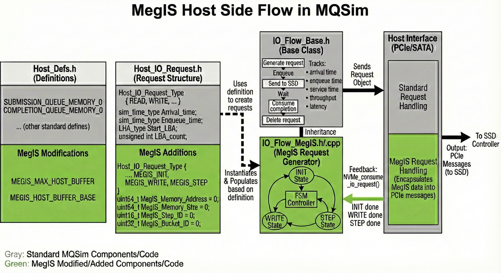
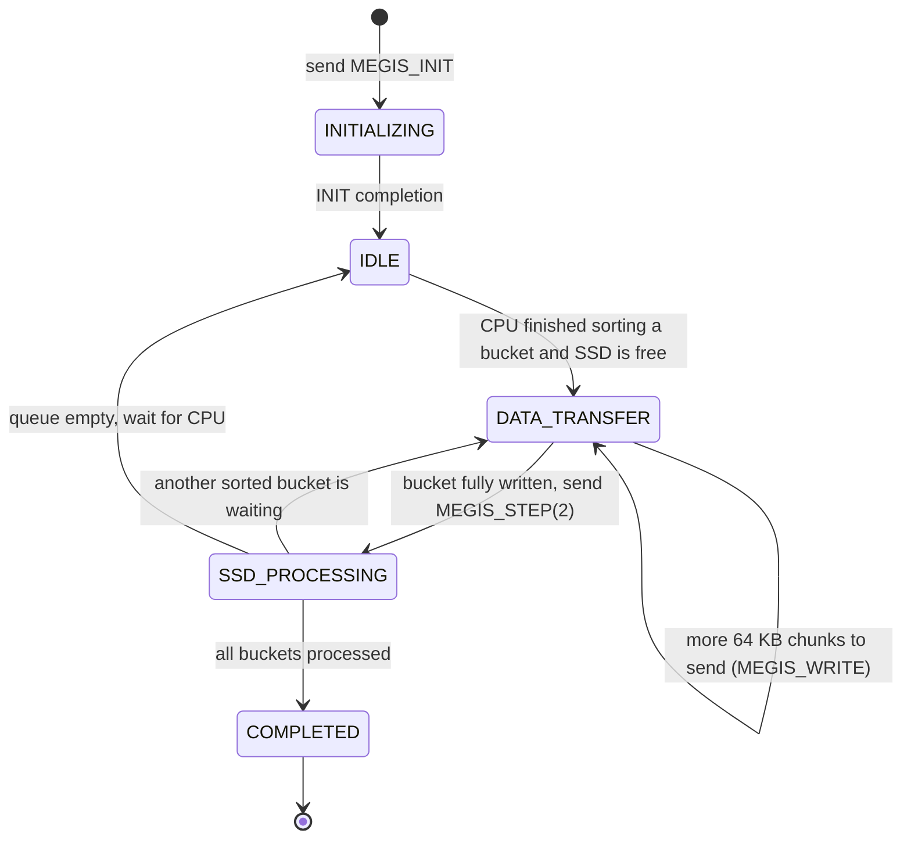
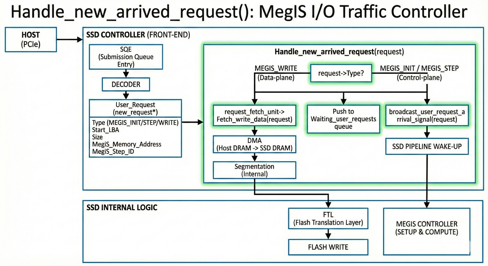
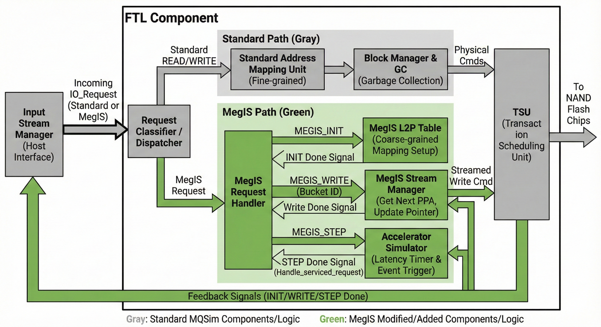
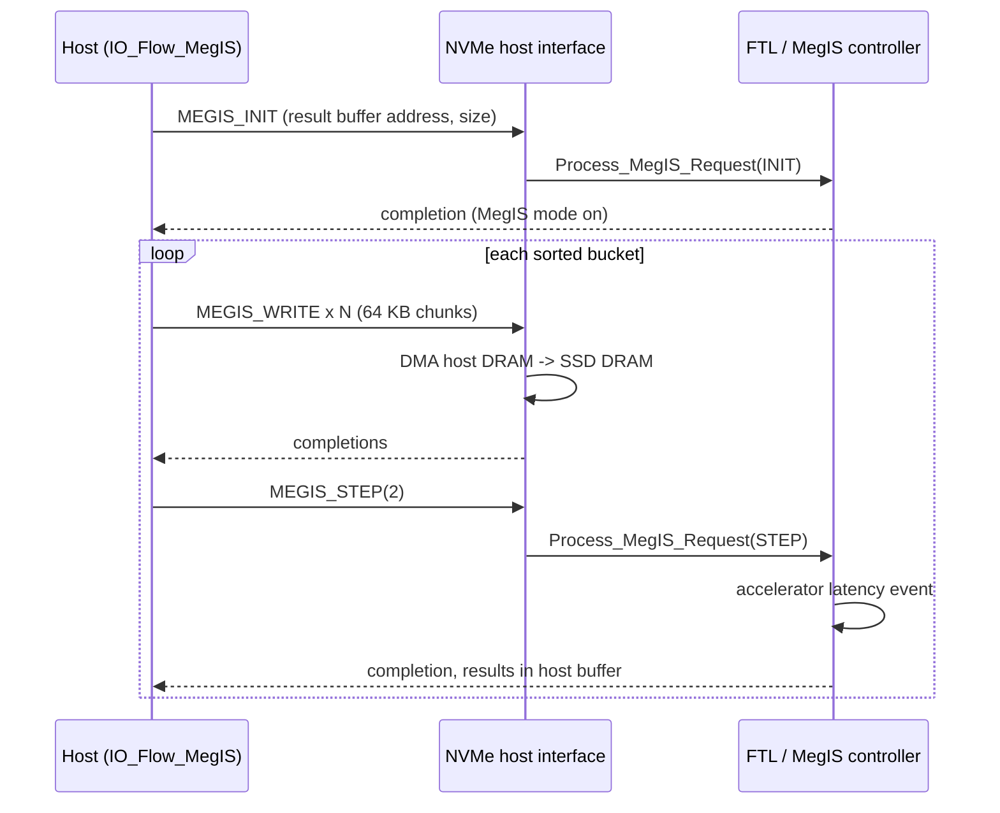
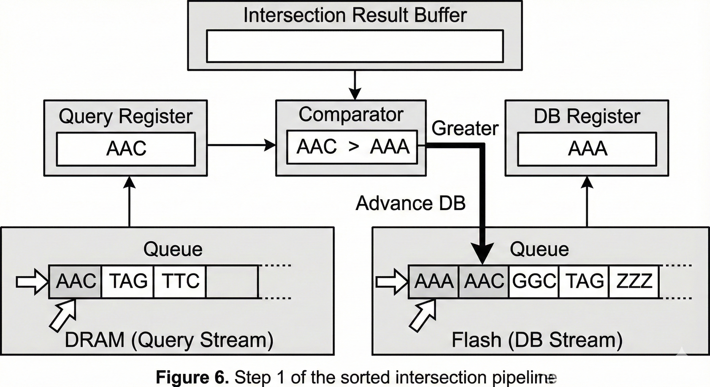
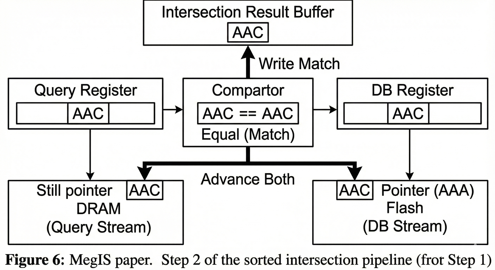
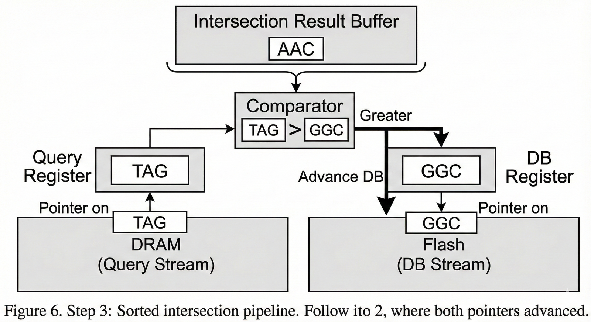
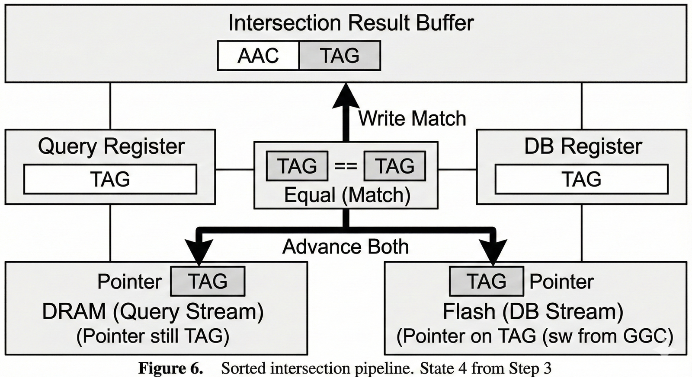
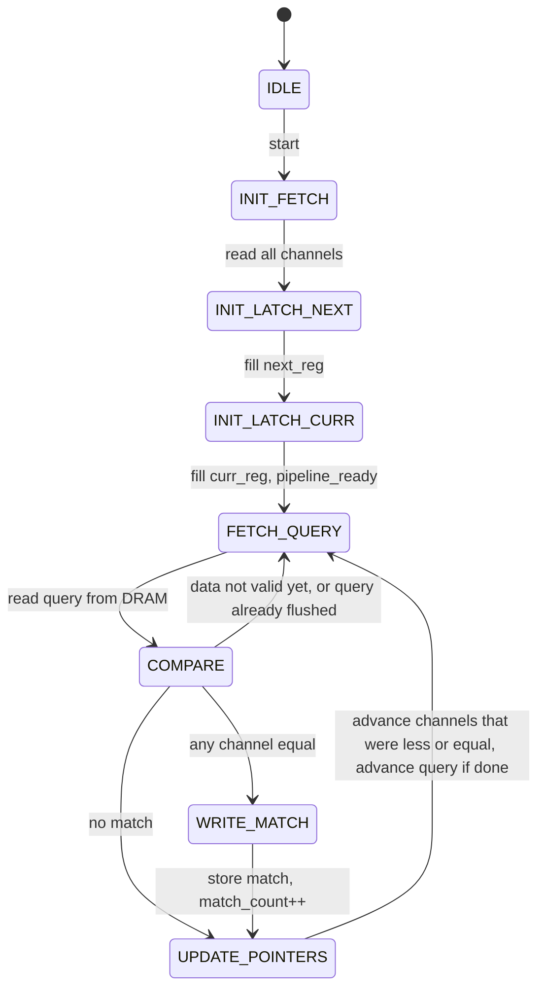

# MegIS Replication: In-Storage Processing for Metagenomic Analysis

UG student replication of **MegIS** (Mansouri Ghiasi et al., ISCA 2024), carried out as a B.Sc. Electrical Engineering Final Year Design Project (FYDP-35) at the University of Engineering and Technology (UET) Lahore.

MegIS reduces the storage-I/O bottleneck in metagenomic analysis by splitting the work between the host and the SSD. The host extracts and sorts k-mers. The SSD intersects them with a reference database stored in NAND flash and retrieves taxonomic IDs, so only results cross the PCIe link.

We rebuilt two parts of that system so we could understand it end to end:

1. **Host–SSD protocol in MQSim.** Custom NVMe commands, a pipelined host I/O flow, firmware dispatch and a MegIS mode in the FTL (`mqsim_megis/`).
2. **In-storage accelerator in RTL.** A 4-channel SystemVerilog design that first intersects sorted query k-mers in SSD DRAM with sorted reference k-mers streamed from flash (MegIS Step 2), then retrieves the taxonomic IDs of the matches and writes them to host memory (MegIS Step 3) (`rtl/`).

> **Note:** This is an independent educational replication. It is not the official MegIS artifact, and its timing numbers are not the paper's results. The original work is by Nika Mansouri Ghiasi, Mohammad Sadrosadati, Harun Mustafa, Arvid Gollwitzer, Can Firtina, Julien Eudine, Haiyu Mao, Joël Lindegger, Meryem Banu Cavlak, Mohammed Alser, Jisung Park and Onur Mutlu (SAFARI Research Group, ETH Zürich). See [References](#references).

---

## Repository layout

```
megis-isp-replication/
├── mqsim_megis/                 # MegIS extensions to the MQSim SSD simulator
│   ├── apply.sh                 # copies the modified files over a clean MQSim checkout
│   └── src/                     # same folder layout as MQSim's src/
│       ├── host/                # IO_Flow_MegIS (host FSM), NVMe SQE packing, stats
│       ├── ssd/                 # opcode decoding, request routing, FTL MegIS mode
│       ├── exec/                # flow creation, FTL <-> host-interface wiring
│       ├── utils/
│       └── main.cpp             # parses the IO_Flow_Parameter_Set_MegIS workload tag
│   └── workloads/
│       └── megis_workload.xml   # example MegIS workload (171 requests)
├── rtl/
│   ├── phase1_intersection/     # Step 2: 4-channel k-mer intersection engine + testbench
│   ├── phase2_taxid/            # Step 2 + Step 3: intersection followed by TaxID retrieval
│   ├── test_vectors/            # alternative query dataset for the Phase 1 DRAM model
│   ├── tools/                   # k-mer dataset generators and a flash SRAM model
│   └── run_sim.sh               # Icarus Verilog script: phase1 | phase2
├── verification/                # cycle-accurate Python models of the RTL + random stress test
└── docs/
    ├── diagrams/                # draw.io sources (open at app.diagrams.net)
    ├── figures/                 # explanatory figures used in this README
    └── html/                    # protocol flow, FSM and status pages (open in a browser)
```

---

## Part 1: Host–SSD protocol in MQSim

### Custom NVMe commands

| Command | Opcode | Direction | Fields in the submission queue entry | Role |
|---|---|---|---|---|
| `MEGIS_INIT`  | `0x80` | Host → SSD | DW0–1: host result-buffer address, DW2: buffer size | Starts a session, turns on the FTL's MegIS mode and records where results will be DMA'd |
| `MEGIS_WRITE` | `0x82` | Host → SSD | DW0–1: start LBA, DW2: sector count | Transfers one sorted k-mer bucket into SSD DRAM, in 64 KB chunks |
| `MEGIS_STEP`  | `0x81` | Host → SSD | DW0: step ID (2 = intersection, 3 = TaxID / abundance) | Starts in-storage processing on the bucket |

The opcodes are defined in `ssd/SSD_Defs.h`. The host packs them in `host/IO_Flow_Base.cpp` and the SSD decodes them in `ssd/Host_Interface_NVMe.cpp`.

### Host I/O flow (pipelined)

`host/IO_Flow_MegIS.cpp` models MegIS Step 1 on the host as a timed CPU event: 5 ms per bucket, 10 buckets of 1 MB each. Sorting and SSD processing are overlapped. While the SSD intersects bucket *i*, the CPU is already sorting bucket *i+1*, and a queue between them buffers the sorted buckets.





### SSD side: routing and firmware

`Handle_new_arrived_request()` splits MegIS traffic into a **data plane** and a **control plane**:

- `MEGIS_WRITE` goes down the normal write path (DMA from host DRAM to SSD DRAM).
- `MEGIS_INIT` and `MEGIS_STEP` go straight to `FTL::Process_MegIS_Request()`, which acts as the MegIS controller.



In the FTL:

- `MEGIS_INIT` enables MegIS mode, stores the host result-buffer address and sets up a coarse-grained L2P mapping entry for the database. This follows the data-mapping idea in Section 4.5 of the paper.
- `MEGIS_STEP` models the accelerator as a timed event and sends the NVMe completion when it fires.





### Using it

```bash
git clone https://github.com/CMU-SAFARI/MQSim.git
bash mqsim_megis/apply.sh ./MQSim
cd MQSim && make
# In ssdconfig.xml set <Enabled_Preconditioning>false</Enabled_Preconditioning>
# (the MegIS flow does not provide workload statistics for preconditioning).
./MQSim -i ssdconfig.xml -w ../mqsim_megis/workloads/megis_workload.xml
```

Only the files we changed are included. They replace their originals in an MQSim checkout. Every change is marked `[MEGIS EDIT]`, `[MEGIS]` or `[MEGIS FIX]` so it is easy to find. The run prints the controller messages (`MegIS_Controller: ...`), and the output XML reports `MegIS_Init_Count`, `MegIS_Write_Count` and `MegIS_Step_Count` for the flow.

### Status

| Component | Status |
|---|---|
| Host workload model, bucketization, CPU/SSD pipelining | Done |
| Custom NVMe commands: packing, decoding, routing | Done |
| Example MegIS workload | Done (`mqsim_megis/workloads/megis_workload.xml`) |
| Firmware dispatch, MegIS mode, INIT context | Done |
| Accelerator timing | **Placeholder.** Step latencies in `FTL.cpp` are fixed estimates, not derived from the RTL |
| Bucket mapping table in the FTL; keeping MegIS data separate from user data | In progress |
| GC and wear leveling for buckets, result DMA to host, benchmarking against Kraken2 and Metalign | Planned |

---

## Part 2: In-storage accelerator (RTL)

### Phase 1: k-mer intersection (MegIS Step 2)

`rtl/phase1_intersection/megis_top.sv` intersects sorted query k-mers with sorted reference k-mers as a streaming merge across **4 flash channels**:

- **`nand_flash_sim`** models 4 NAND channels. Each streams its slice of the sorted reference database, one 10-bit k-mer per read.
- **`dram_module`** models SSD DRAM. It holds the sorted query k-mers (addresses 0–9) and collects matches (addresses 10 and up).
- **Per channel:** a `next_reg` → `curr_reg` double buffer prefetches the next flash entry, and an `intersector` comparator (`less`, `equal`, `greater`) compares it with the current query.
- **Controller FSM:** advances each channel independently and moves to the next query once a match is found or all channels have passed it. A finished query is flushed (written to 0) in DRAM.

| Step 1 | Step 2 |
|---|---|
|  |  |
| **Step 3** | **Step 4** |
|  |  |



**K-mer encoding:** 2 bits per base (A=00, C=01, G=10, T=11), so a 5-mer is 10 bits. For example, `1100000000` = `TAAAA`.

### Phase 2: TaxID retrieval (MegIS Step 3)

`rtl/phase2_taxid/megis_top.sv` runs Phase 1 and then goes straight into a second phase (`P2_*` states) that looks up the taxonomic IDs of the matched k-mers:

- **Channel 0** streams 42-bit entries `{TaxID (32 bits), 5-mer (10 bits)}`, sorted by k-mer.
- **Channel 1** streams the TaxIDs of the matching 4-mer prefixes.
- **`index_generator`** compares the 8-bit (4-mer) prefixes of `curr_reg[0]` and `next_reg[0]`. When the prefix changes, it raises `prefix_change`, which advances channel 1. That keeps the 5-mer and 4-mer streams aligned without any random flash access.
- On each match with a Phase 1 result in DRAM, the controller writes `{TaxID_5mer, TaxID_4mer}` to **`host_memory`**. This models the result DMA back to the host.

The testbench checks the five Phase 1 matches (`23, 28, 33, 46, 65`) in DRAM, then the five `{TaxID_5mer, TaxID_4mer}` pairs written to host memory.

### Known limitations

- The value `0` marks a query as processed, so the all-`A` k-mer (`AAAAA` = 0) cannot be used as a query.
- The DRAM model holds 10 queries at addresses 0–9 and results from address 10, and the query count is fixed at 10 in the controller.
- Phase 1 reads flash row 0 twice during start-up. The duplicate is harmless because the merge skips equal or smaller entries. Phase 2 removes it.

### Running the simulations

```bash
bash rtl/run_sim.sh phase1    # intersection only
bash rtl/run_sim.sh phase2    # intersection + TaxID retrieval
```

Both need Icarus Verilog 11+ (`iverilog -g2012`). `rtl/test_vectors/dram_module_dataset_b.sv` is a second Phase 1 query set that mixes matching and non-matching k-mers. To use it, swap it in for `phase1_intersection/dram_module.sv` and update the checks in the testbench.

### Tools

- `rtl/tools/gen_kmers_*.py` generate every 5-mer in lexicographic order, split into 4 channel columns (by range or by last base) and encoded in 2-bit binary. We used them to build the flash datasets.
- `rtl/tools/kmer_sram.sv` is a synthesizable 4-channel flash model with a built-in AAAAA–TTTTT pattern, plus a testbench that prints the table.

---

## Verification

`verification/` contains cycle-accurate Python models of both RTL phases. They mirror the SystemVerilog line by line: combinational logic is evaluated from the current register values, and all registers update together at each rising edge. They use the same reset, start and timing as the testbenches.

```bash
cd verification
python3 model_phase1.py     # both Phase 1 datasets
python3 model_phase2.py     # Phase 1 + Phase 2, all testbench checks
python3 stress_phase1.py    # 3000 random query sets vs. a set-intersection reference
```

| Check | Result |
|---|---|
| Phase 1, dataset A (testbench data) | 10/10 matches; all 4 testbench checks pass |
| Phase 1, dataset B | 5/5 matches, non-matching k-mers correctly skipped |
| Phase 1, 3000 random query sets + edge cases | 0 wrong results, all finished within the testbench window |
| Phase 2, intersection + TaxID retrieval | all 10 testbench checks pass; reaches `DONE` at 2215 ns (testbench checks at 3040 ns) |

Fixes made during verification:

- **RTL:** Phase 1 `nand_flash_sim` array ports were declared `[CHANNELS-1:0]` while `megis_top` uses `[0:3]`. Unpacked arrays connect by position, so the channels were crossed (wrong on 56 of 2000 random query sets in the model). They are now ascending, as in Phase 2.
- **RTL:** a bit flip in the Phase 2 flash table (row 27, channel 3: 242 instead of 114) broke the sorted order. Fixed.
- **RTL:** the flash tables are now loaded with plain assignments in a single `initial` block instead of a 2-D `'{...}` initializer, for wider simulator support.
- **MQSim:** restored MQSim's `Flow_Type` enum (with `MEGIS` added), which an earlier edit had replaced. Also fixed the MegIS case in `Host_System.cpp` and its constructor arguments, a missing closing brace in `Host_Interface_NVMe.cpp`, the scope of `FTL::MEGIS_EVT_ID`, and FTL access to the host interface, via a public `Complete_MegIS_request()` hook. Added stop-condition fields and an example workload.

---

## Diagrams

| File | Content |
|---|---|
| `docs/diagrams/intersection_engine_datapath_fsm.drawio` | Phase 1 datapath (4 channels, registers, comparators, address muxes) and FSM |
| `docs/diagrams/two_phase_controller_fsm.drawio` | Full controller FSM covering both the intersection and TaxID phases |
| `docs/diagrams/phase2_taxid_datapath.drawio` | Phase 2 datapath with index generation and host-memory write port |
| `docs/diagrams/host_io_flow_fsm.drawio` | Host-side MegIS I/O flow FSM |
| `docs/html/megis_flow_host.html` | Step-by-step protocol walkthrough, from host request to SSD action |

---

## Team

**FYDP-35, Department of Electrical Engineering, UET Lahore**

| Member | Focus |
|---|---|
| Hamza Ahmad | Host-side integration: query preparation and the host–SSD communication protocol in MQSim |
| Ume e Abiha | Host-side preprocessing and k-mer extraction |
| Zain Saeed | SSD-side firmware and hardware: FTL changes and accelerator design |
| Arshique Rana | SSD-side system design and NVMe coordination |

Supervisor: Ms. Bareera Sadia. Co-supervisor: Mr. Rehan Naeem.

---

## References

1. N. Mansouri Ghiasi, M. Sadrosadati, H. Mustafa, A. Gollwitzer, C. Firtina, J. Eudine, H. Mao, J. Lindegger, M. B. Cavlak, M. Alser, J. Park, O. Mutlu. *MegIS: High-Performance, Energy-Efficient, and Low-Cost Metagenomic Analysis with In-Storage Processing.* ISCA 2024. [arXiv:2406.19113](https://arxiv.org/abs/2406.19113)
   Official implementation: [github.com/CMU-SAFARI/MegIS](https://github.com/CMU-SAFARI/MegIS). We studied its `hdl/` units and `finding-candidate-species/` baseline while designing ours. They are not included here; please use the original repository.
2. A. Tavakkol et al. *MQSim: A Framework for Enabling Realistic Studies of Modern Multi-Queue SSD Devices.* FAST 2018. [github.com/CMU-SAFARI/MQSim](https://github.com/CMU-SAFARI/MQSim)

## License

Files under `mqsim_megis/src/` are modified versions of MQSim sources and remain under MQSim's license. See the MQSim repository.
